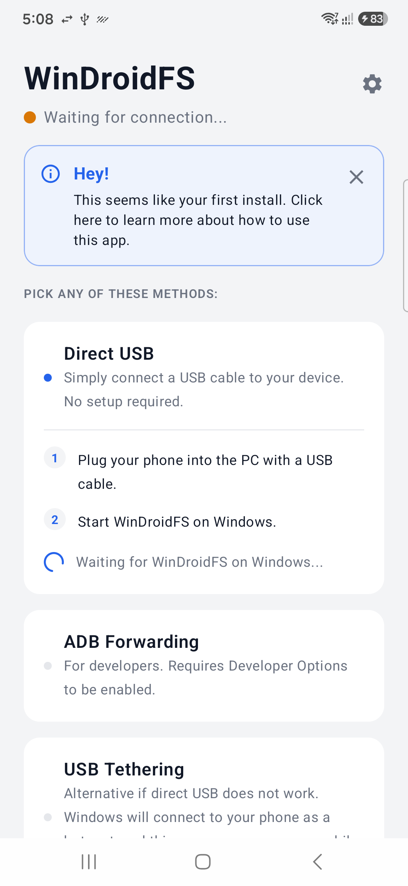
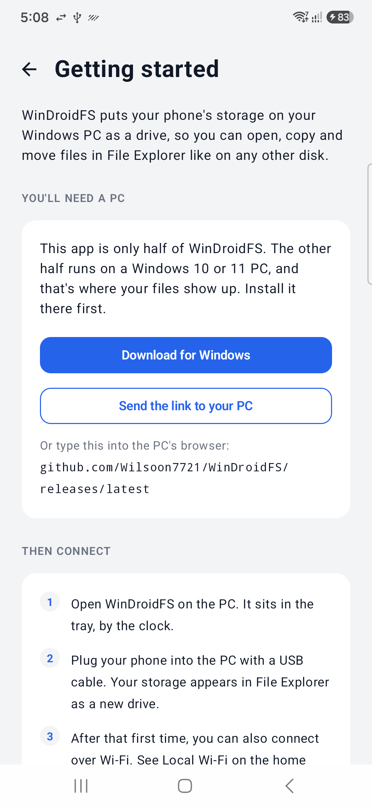
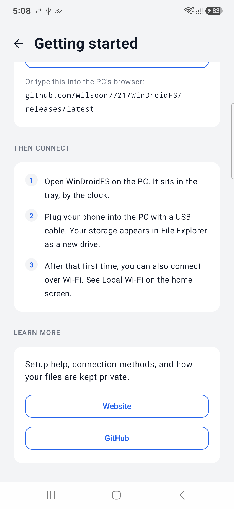
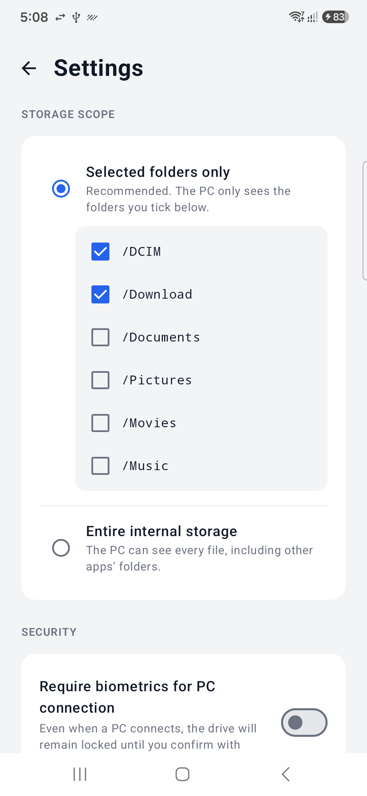
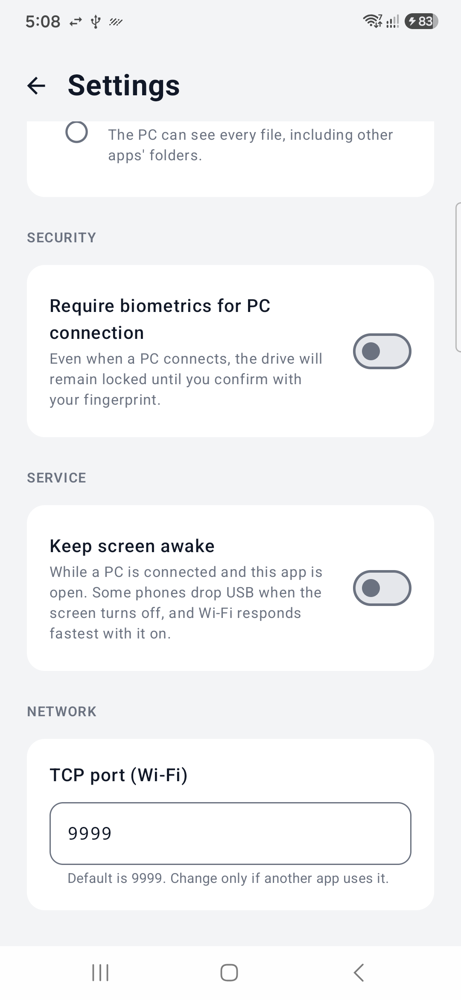
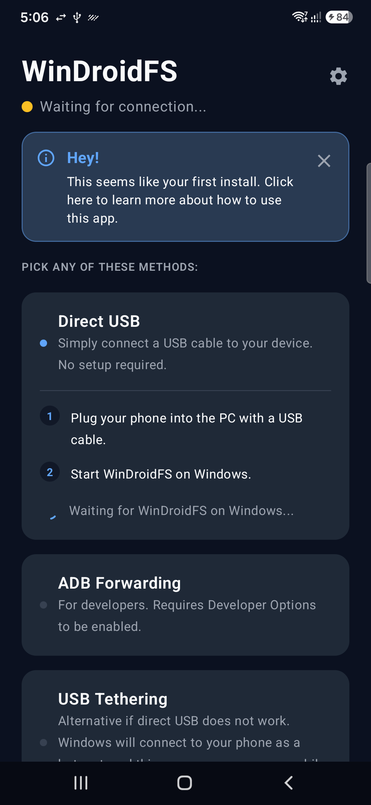
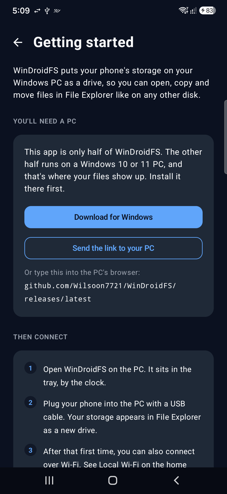
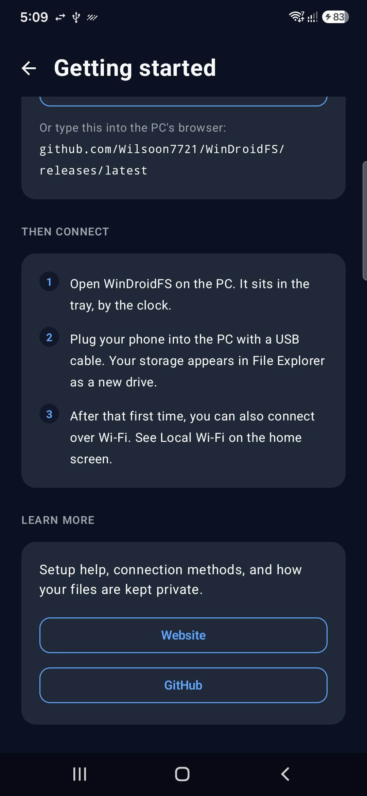
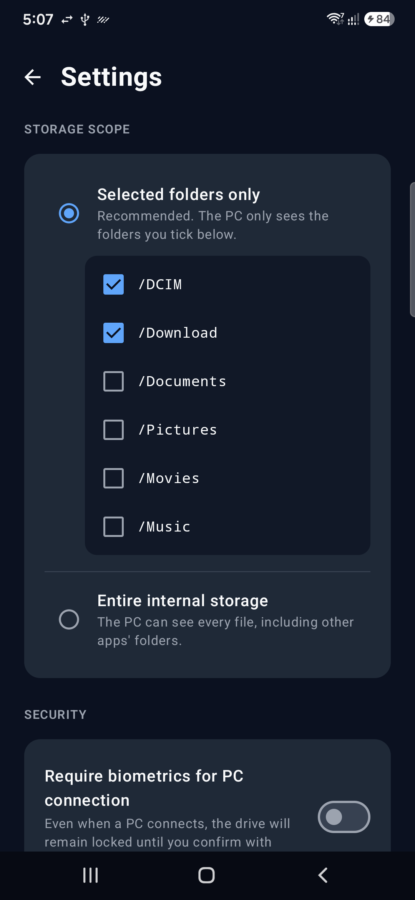
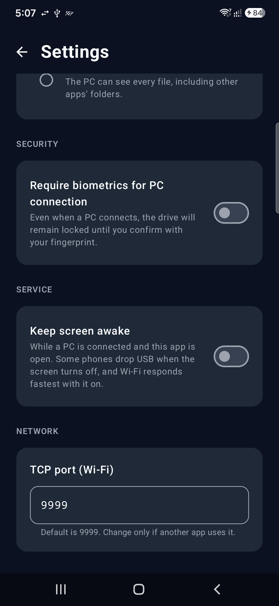

# WinDroidFS

WinDroidFS bypasses the traditionally unstable Windows Media Transfer Protocol (MTP) by using the Android Open Accessory (AOA) protocol. It establishes a high-speed, raw binary pipe between your PC and your phone, treating your Android device like a standard local flash drive.

## Screenshots

<table>
  <tr><th></th><th>Home</th><th>Getting started</th><th>Getting started (continued)</th><th>Settings</th><th>Settings (continued)</th></tr>
  <tr><th>Light</th><td></td><td></td><td></td><td></td><td></td></tr>
  <tr><th>Dark</th><td></td><td></td><td></td><td></td><td></td></tr>
</table>

## Architecture

WinDroidFS is built as a Turborepo-powered monorepo consisting of 3 components:

- **WindroidFS for Windows (Rust, runs as a service):** A high-performance systems daemon that scans the USB bus, initiates the AOA hardware handshake, and mounts the incoming byte stream as a native Windows virtual drive.
- **Android Host (Kotlin, with support for Android >= 7.0):** A native Android application that receives the raw USB accessory intent, reads the local file system, and pipelines data directly to the PC.
- **Binary Protocol (Protobuf):** A typed, language-agnostic schema compiled into both Rust and Kotlin to dictate how file chunks and commands are requested over the raw endpoints.

## Connection Methods

WinDroidFS is designed to fall back gracefully if standard raw USB access is blocked by the host OS:

1. **Direct USB (via AOA):** The primary method. A high-speed raw pipe that requires zero setup on the Android side.
2. **ADB Forwarding:** A developer-focused transport layer utilizing USB Debugging.
3. **USB Tethering:** A fallback that routes TCP over a USB network interface, ensuring compatibility on heavily locked-down Windows machines.
4. **Local Wi-Fi:** A completely wireless transfer method using the local network.

## Configuration

The Android application allows the phone to control several settings:

- **Storage Scope:** The user can choose the folders they want to share with the PC, or the entire device storage.
- **Biometric Authentication:** The user can choose to enable or disable biometric authentication.
- **Keep Screen Awake:** The user can keep the screen on while a PC is connected, so the phone doesn't lock mid-transfer.
- **Wi-Fi Port:** The user can change the port the phone listens on for Local Wi-Fi connections.

## Verifying the Android App

Every APK on the releases page is signed with the same key. Before installing, or in an app like [AppVerifier](https://github.com/soupslurpr/AppVerifier), check that it matches:

- **Package name:** `dev.wilsoon.windroidfs`
- **SHA-256 hash of signing certificate:**
  `E6:95:D9:25:BF:29:45:8F:D8:C9:8B:80:D0:5A:93:0D:65:9E:5D:7E:00:45:EF:EC:CD:EA:C0:F7:F0:39:80:63`

To check a downloaded APK on your PC, use `apksigner` from the Android SDK build-tools:

```bash
apksigner verify --print-certs WinDroidFS.apk
```

If the hash doesn't match, don't install it. An APK signed with any other key didn't come from me and Android won't update it over a genuine copy either.

## Potential New Features

If you have additional ideas, feel free to open an issue or start a pull request.
These are some of the ideas I thought about but haven't actually started researching the feasbility of:

- Allowing rooted devices to access their root filesystem

## License

WinDroidFS is licensed under the [GNU General Public License v3.0](LICENSE).
